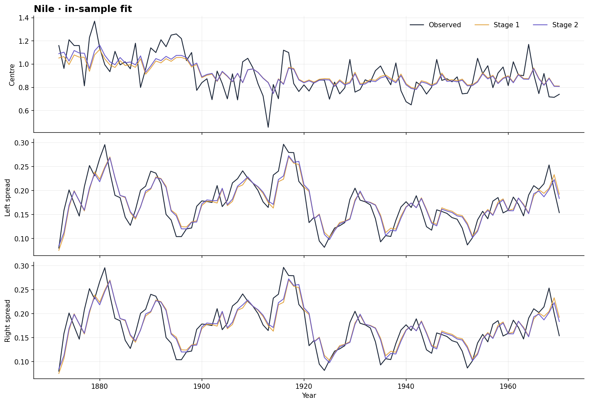
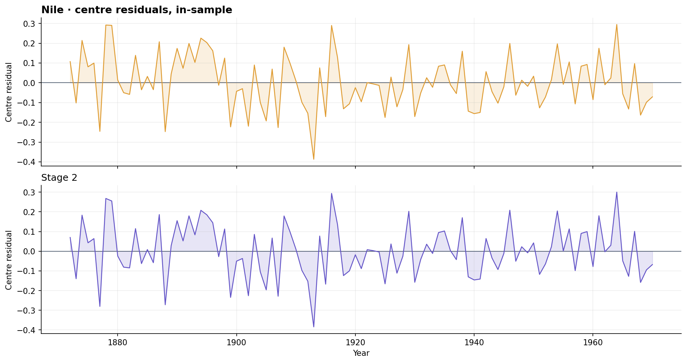
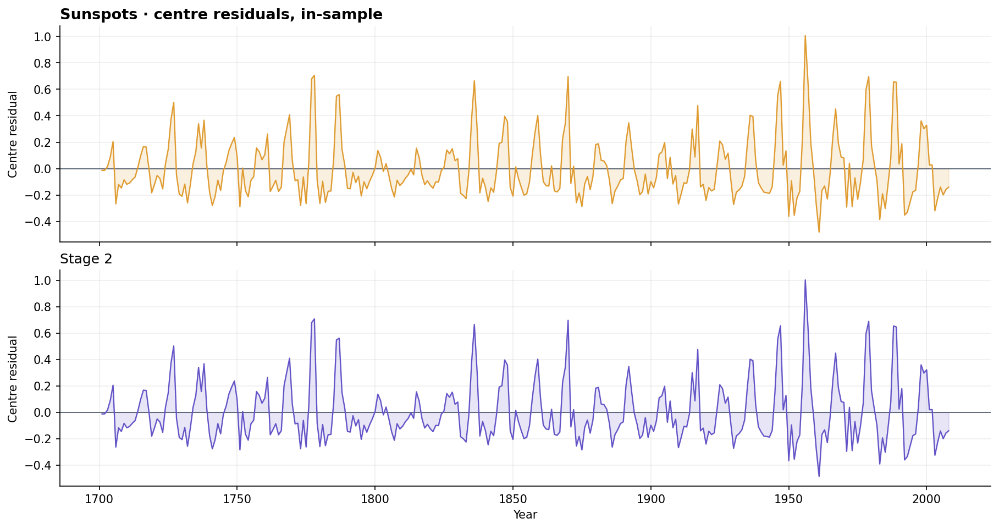
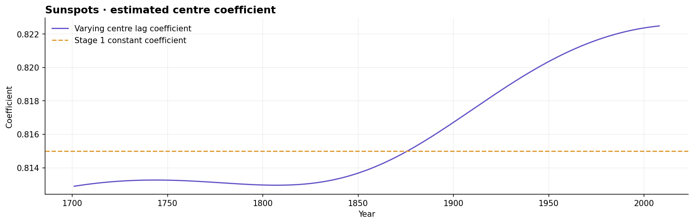

# SPVC-FTS

Python implementation in progress of the two-stage semiparametric varying-coefficient fuzzy time-series model described by Chen L. and Lu Q. J., *Mathematical Modeling and Its Applications*, 15(1), 10–20 (2026), DOI: 10.19943/j.2095-3070.jmmia.2026.01.02.

**Status / 复现状态：** 两阶段拟合、四种核函数、留一带宽选择、模糊化、MSE、MAE 和三角模糊数 MSM 已实现并通过合成数据测试；**尚未取得并核实论文原始数据，也尚未复现论文表格结果或基线模型。** 实现中未明确的地方使用下述假设，不能声称数值已复现。

## 实验结果 / Experimental results

### 论文报告的结果（未独立复现）

下表直接摘录论文表 1、表 2 的作者报告结果，**不是本仓库程序复算结果**。金融数据的 MSE、MAE 分别以 10⁻⁶、10⁻³ 为单位；上海气温数据使用论文表中的原始数值。气温第二阶段的 MAE 在正文中另写为 0.6602，表中为 0.6620。

| 算例 | 模型 | MSE | MAE | MSM |
|---|---|---:|---:|---:|
| 深证成指 | 第一阶段 | 1.3606 | 2.6392 | 0.6165 |
| 深证成指 | 第二阶段 | 0.6822 | 1.7334 | 0.7033 |
| 黄金价格 | 第一阶段 | 2.7441 | 3.6320 | 0.5481 |
| 黄金价格 | 第二阶段 | 1.5642 | 2.6927 | 0.6023 |
| 上海气温 | 第一阶段 | 2.2992 | 0.8617 | 0.5122 |
| 上海气温 | 第二阶段 | 1.8799 | 0.6620 | 0.5611 |

### 补充实验：公开真实数据（样本内拟合）

下表由本仓库代码实际计算，使用 [Nile](https://www.statsmodels.org/stable/datasets/generated/nile.html) 年径流及 [Sunspots](https://www.statsmodels.org/stable/datasets/generated/sunspots.html) 年太阳黑子数；两组数据不是论文原始算例，不能与上表直接比较。两者原本为精确数，本实验人为构造对称三角模糊数：中心依次除以 1000、100，左右展形均为 `0.04 + 最近至多 5 次相邻变化绝对值的均值`；该变换是补充实验的设定，并非论文采用的模糊化方法。展形使用当期观测值。使用一阶滞后、高斯核和固定带宽 0.25；参数未在本实验中调优。结果为样本内拟合，**不代表样本外预测性能**。

| 数据集 | 模型 | 拟合点数 | MSE ↓ | MAE ↓ | MSM ↑ |
|---|---|---:|---:|---:|---:|
| Nile | 第一阶段 | 99 | 0.020552 | 0.157482 | 0.392802 |
| Nile | 第二阶段 | 99 | 0.019788 | 0.153177 | 0.400243 |
| Sunspots | 第一阶段 | 308 | 0.054595 | 0.225610 | 0.315962 |
| Sunspots | 第二阶段 | 308 | 0.054535 | 0.224784 | 0.316659 |

**Nile：拟合曲线、中心残差和中心滞后系数**





**Sunspots：拟合曲线、中心残差和中心滞后系数**





两组数据原件、逐点拟合值和实验汇总分别位于 `data/`、`results/`；来源为 statsmodels 公共领域数据集（[Nile 元数据](https://github.com/statsmodels/statsmodels/blob/main/statsmodels/datasets/nile/data.py)，[Sunspots 元数据](https://github.com/statsmodels/statsmodels/blob/main/statsmodels/datasets/sunspots/data.py)）。运行 `PYTHONPATH=. python experiments/run_benchmarks.py` 可重新生成所有结果和图片，具体数值可能受数值库版本影响。

## Install and run / 安装与运行

```bash
python -m pip install -r requirements.txt
python -m unittest discover -s tests -v
python examples/generate_demo.py
python -m spvc_fts examples/synthetic.csv --lags 1 1 1 --h-np 0.3 --h-vc 0.3
# Optional explicit candidate grid; this is substantially slower:
python -m spvc_fts examples/synthetic.csv --lags 1 1 1 --cv-grid 0.2 0.3 0.4
```

Input CSV columns: `center,left,right`. Outputs `fitted.csv` and `summary.json`. The example is **synthetic**, used only to verify the code runs; it is not paper data. Output numbers measure **in-sample fit**, not future forecasting performance. The prediction arrays can contain nonpositive spreads because the paper does not specify a positivity-constrained optimizer. Their count is reported, and MSM is null if any spread is nonpositive. No silent clipping is performed.

## Model and implementation choices / 模型及实现约定

- Stage 1 uses equations (1)–(3), normalized kernel smoothing of centre residuals, and iterative reweighted nonlinear least squares with weights `1/(1+d²)`; stage 2 locally minimizes the fuzzy squared distance with the fixed stage-1 smooth trend. For triangular fuzzy numbers the distance weights are `(2/3, 1/3, 1/3)`.
- Gaussian, Epanechnikov, biweight and triweight kernels are available. Explicit bandwidth grids are required; the paper specifies a 0.01 increment but no finite upper bound. The example grid and default bandwidth are illustrative, not values extracted from the paper. Compact kernels require sufficient local observations; unsupported folds are marked invalid.
- CV removes each target response from the regression rows and smoothing; stage 2 refits stage 1 per fold. Other rows retain lagged observations from the original series, including the held-out observation. Hence this is **leave-one-response-out**, not strict removal of all dependent lagged values, and not rolling-origin forecasting. The paper does not unambiguously specify this detail.
- MSE and MAE are the sample means of componentwise **sums** per paper §2.3. MSM is fuzzy-cardinality intersection/union computed by exact piecewise-linear integration for triangular fuzzy numbers. It requires strictly positive spreads.
- `financial_returns(low, high)` implements paper p. 15 in natural-log units. Table 1 expresses MSE in 10⁻⁶ and MAE in 10⁻³; raw output must be scaled to compare with the table. `temperature_fuzzy(values)` implements p. 17 using population variance. A point whose normal tail contains at most 0.05 probability has no finite spread satisfying the stated equation; this raises an error rather than inventing a workaround.

## Unresolved reproduction issues / 待解决问题

1. The paper describes Shenzhen index daily high/low (2023-02-24–2023-12-15), gold daily high/low (2023-07-19–2024-09-20), and Shanghai daily mean temperature (2024-01-01–2024-09-30), but the PDF does not provide the raw observations, exact providers or market/instrument conventions. It also does not unambiguously explain how differencing is applied in the temperature experiment.
2. Exact kernel selections, practical bandwidth search limits, numerical optimizer and convergence settings are not fully specified. Obtaining original code/data would help distinguish assumptions from the authors' implementation.
3. Section 3.2 text reports temperature MAE 0.6602, whereas Table 2 reports 0.6620. Both are retained pending confirmation.
4. The paper's baseline models and result tables have not been independently reproduced. No synthetic result should be compared as if it were a paper result. Add source provenance, exact data and chronological evaluation before making accuracy claims.
