# SPVC-FTS

Python implementation in progress of the two-stage semiparametric varying-coefficient fuzzy time-series model described by Chen L. and Lu Q. J., *Mathematical Modeling and Its Applications*, 15(1), 10–20 (2026), DOI: 10.19943/j.2095-3070.jmmia.2026.01.02.

**Status / 复现状态：** 两阶段拟合、四种核函数、留一带宽选择、模糊化、MSE、MAE 和三角模糊数 MSM 已实现，并已使用深证成指、黄金和上海气温数据运行。**不同数据源及实现假设会造成结果差异；除自定义 AR 基线及 Cook 距离近似诊断外，原文其他对比方法和模糊异常值检测尚未复现。**

## 实验结果 / Experimental results

### 论文同主题案例：本仓库实际运行

三组数据分别为深证成指（199 条原始价格，2023-02-24 至 2023-12-15）、黄金日 K 线（304 条，时间戳为 2023-07-19 至 2024-09-19）、上海日均气温（123 条，2017-05-01 至 2017-08-31）。**气温年份与论文不同；黄金日 K 线交易时间与论文来源可能不同，条数也不同。** 金融数据使用论文的三角模糊收益率公式；气温以一阶差分为中心。完整结果是样本内拟合而非未来预测。

使用高斯核、三阶滞后；两个阶段分别在 `[0.1, 0.2, 0.3]` 中执行留一带宽选择，最终均选 0.3。该值位于搜索上界，因此不能断言是全局最优。下面的 MSE 和 MAE 使用程序原始单位，金融案例均为自然对数收益率；MSM 越高表示三角模糊数重合程度越高。

| 案例 | 阶段 | 拟合点数 | MSE | MAE | MSM |
|---|---|---:|---:|---:|---:|
| 深证成指 | 第一阶段 | 195 | 0.0000727631 | 0.00980333 | 0.466232 |
| 深证成指 | 第二阶段 | 195 | 0.0000716244 | 0.00977101 | 0.468007 |
| 黄金 | 第一阶段 | 300 | 0.0000613483 | 0.00955912 | 0.531379 |
| 黄金 | 第二阶段 | 300 | 0.0000603579 | 0.00941072 | 0.534770 |
| 上海气温差分 | 第一阶段 | 119 | 2.053913 | 1.148642 | 0.157186 |
| 上海气温差分 | 第二阶段 | 119 | 1.844584 | 1.145944 | 0.168926 |

**气温处理限制：** 将本次 122 个气温差分值直接代入论文的总体均值和标准差时，有 12 个值的单侧正态尾概率不大于 0.05，论文所写的区间概率方程不存在有限解。为使该案例可运行，本实验将标准差从 1.431343 调整至 3.889626，即取原标准差与 `1.05 × max(|x-μ|) / Φ⁻¹(0.95)` 的较大者。此处属于明确的实现假设，不是论文所述标准差；其结果对这一选择敏感。差分后模糊化也是本文对论文描述的具体解释。

数据来源：[深证指数 CSV](https://github.com/1376524890/bigdata_fin/blob/master/real_data/01_%E6%8C%87%E6%95%B0%E6%95%B0%E6%8D%AE/sz_index_daily.csv)、[黄金日 K 线](https://github.com/tohaitrieu/market-history/blob/master/data/commodities/GOLD/GOLD-D1.csv)、[上海气温](https://github.com/Ariza-Sun/MetroFlow/blob/main/Data/MetaData/shanghai_weatherDaily.csv)。原始截取数据、逐点拟合及交叉验证结果保存在 `data/` 和 `results/`，运行 `PYTHONPATH=. OPENBLAS_NUM_THREADS=1 python experiments/run_paper_cases.py` 可重建结果与图片，运行时间较长。

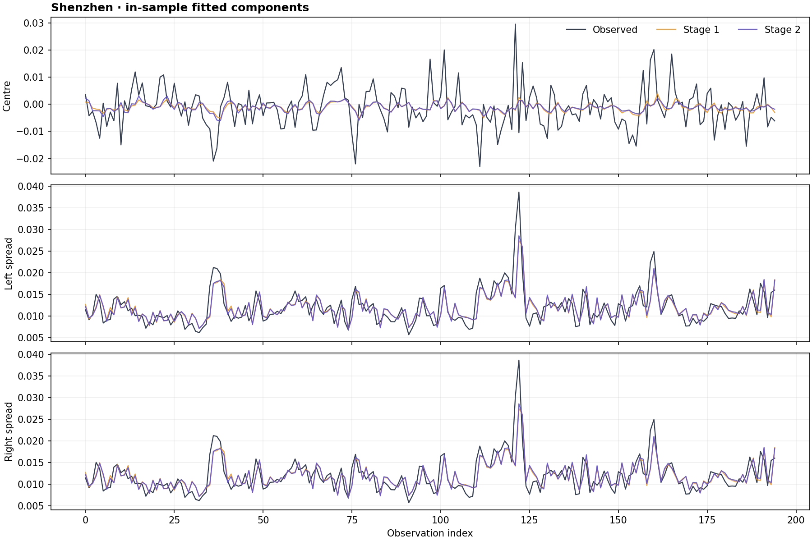
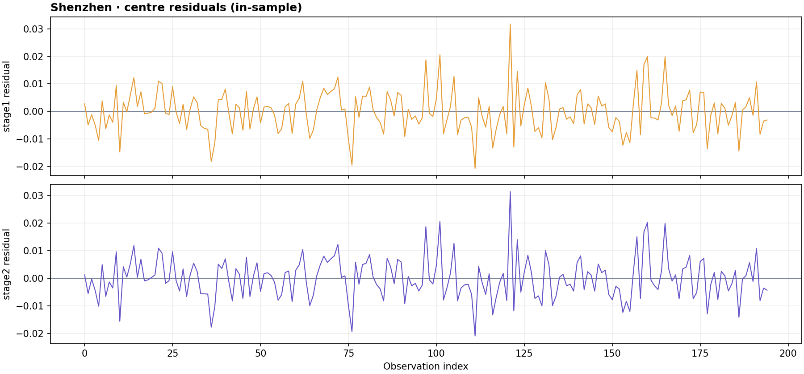
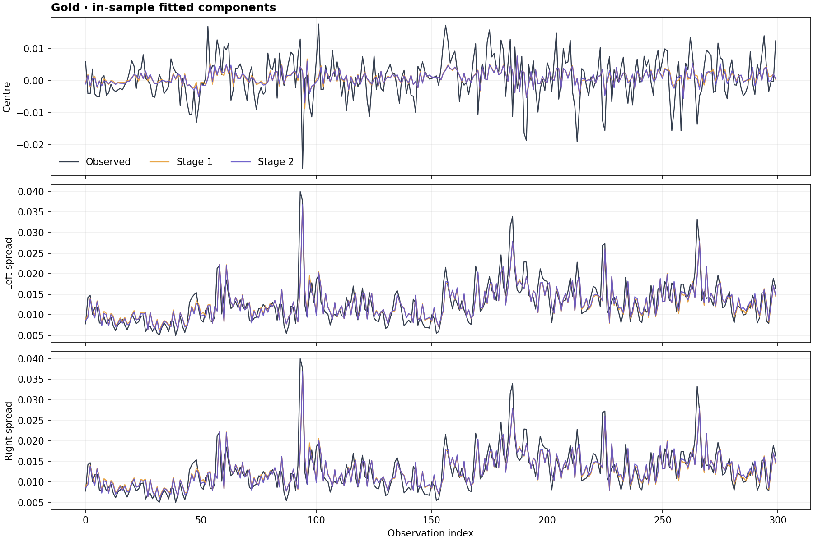
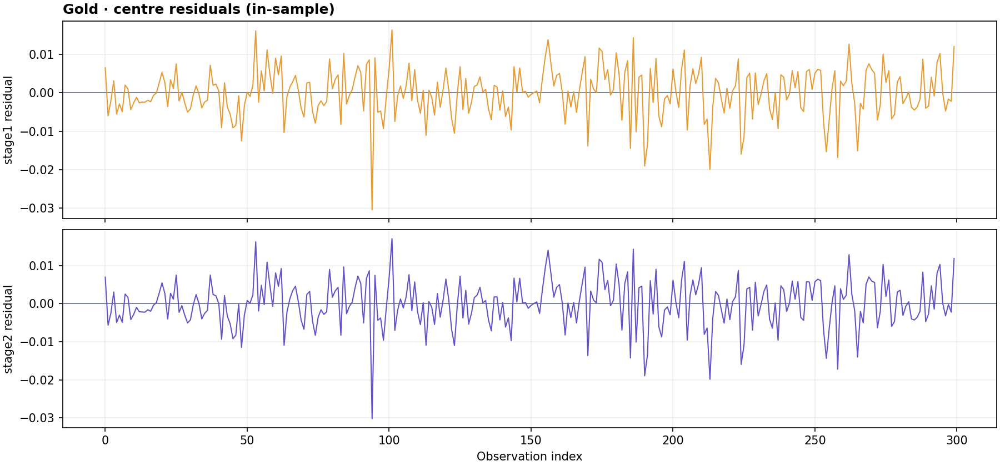
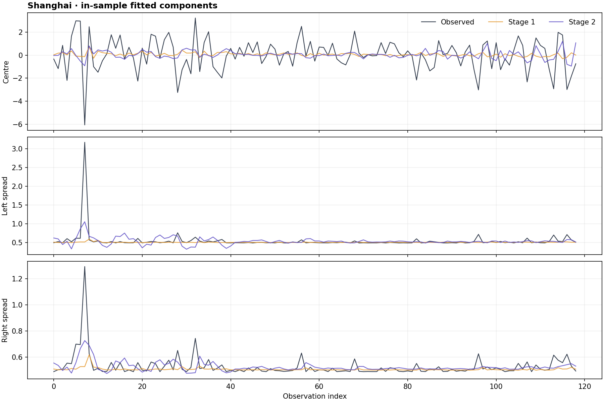
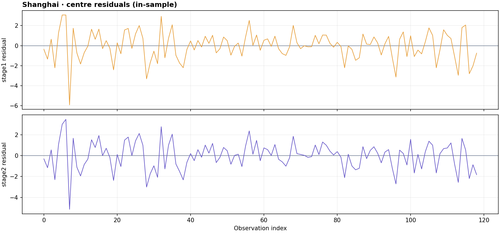

### 补充对比、诊断与核函数分析

以下均使用同一批实验样本和全样本拟合，不能作为样本外预测比较。AR 基线为对中心序列独立拟合的 OLS AR(3)，预测左右展形设为零；由于输出是精确值而非模糊数，按连续面积定义 MSM 为 0，MSE 和 MAE 包含未预测展形的误差。这是本仓库明确指定的基线，**不能认为与论文 AR 的具体实现完全一致**。

| 案例 | 方法 | MSE | MAE | MSM |
|---|---|---:|---:|---:|
| 深证成指 | 中心 AR(3) | 0.00037630 | 0.029681 | 0 |
| 深证成指 | 两阶段模型 | 0.00007162 | 0.009771 | 0.468007 |
| 黄金 | 中心 AR(3) | 0.00041884 | 0.030394 | 0 |
| 黄金 | 两阶段模型 | 0.00006036 | 0.009411 | 0.534770 |
| 上海气温差分 | 中心 AR(3) | 2.556561 | 2.143631 | 0 |
| 上海气温差分 | 两阶段模型 | 1.844584 | 1.145944 | 0.168926 |

**游程检验与异常值诊断。** 游程检验采用中心序列的样本中位数、剔除与中位数相同的值、双侧正态近似，无连续性校正；Cook 距离使用中心序列 AR(3) 的普通最小二乘残差，超出均值 ± 3 倍样本标准差视为标记。该 Cook 图是可复现的**中心序列近似诊断**，并非论文引用方法的模糊 Cook 距离实现；标记点未被删除，游程检验也不能单独证明平稳性。黄金序列的 p 值低于 0.05，表明在该设置下不应声称通过游程检验。

| 案例 | 游程数 | p 值 | Cook 近似标记点 |
|---|---:|---:|---:|
| 深证成指 | 89 | 0.117008 | 4 |
| 黄金 | 110 | 0.00000129 | 6 |
| 上海气温差分 | 65 | 0.585428 | 2 |

**核函数敏感性。** 第一、二阶段均使用相同核，带宽固定 0.3，不重新为各核调参；表中为第二阶段样本内 MSE。紧支撑核与高斯核在相同带宽值下有效权重分布不同，结果不构成公平的最优模型排名。

| 案例 | Gaussian | Epanechnikov | Biweight | Triweight |
|---|---:|---:|---:|---:|
| 深证成指 | 0.00007162 | 0.00007000 | 0.00006851 | 0.00006741 |
| 黄金 | 0.00006036 | 0.00005987 | 0.00005879 | 0.00005808 |
| 上海气温差分 | 1.844584 | 1.784778 | 1.752973 | 1.729389 |

以下为三组案例的中心序列 Cook 近似图、中心滞后系数图、核函数敏感性图。运行 `PYTHONPATH=. OPENBLAS_NUM_THREADS=1 python experiments/run_diagnostics.py` 可重新生成，数值与标记日期见 `results/diagnostics_summary.json`。

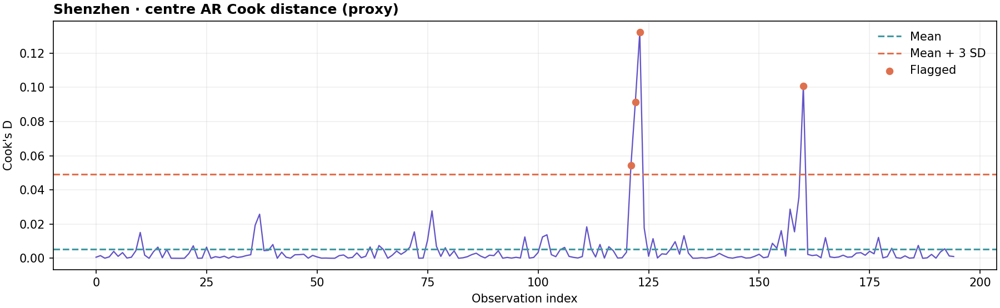
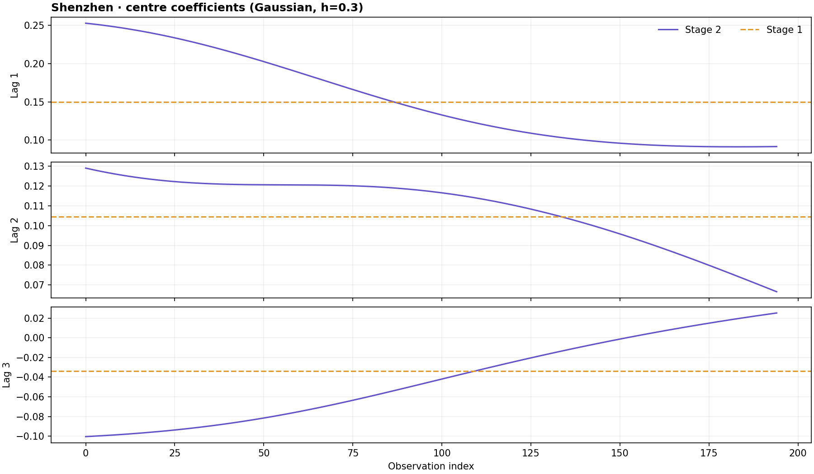
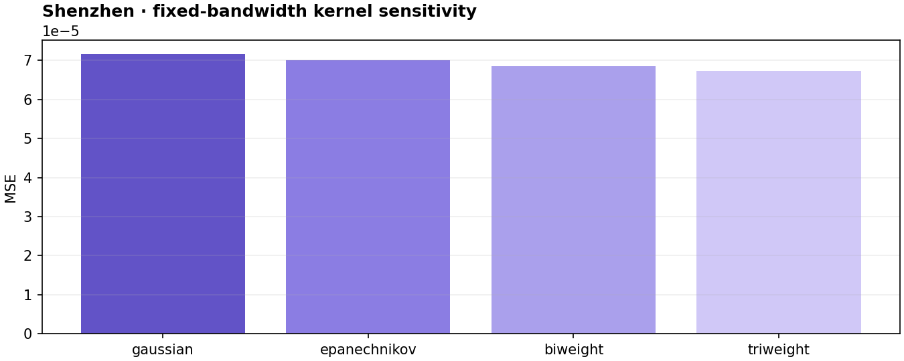
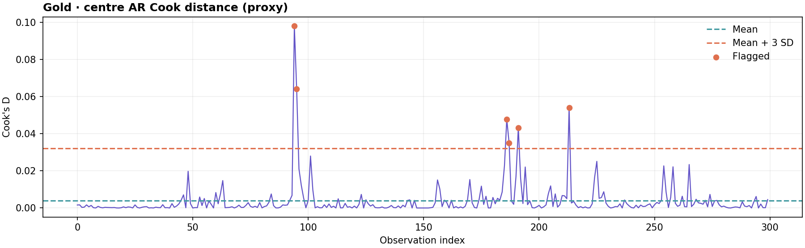
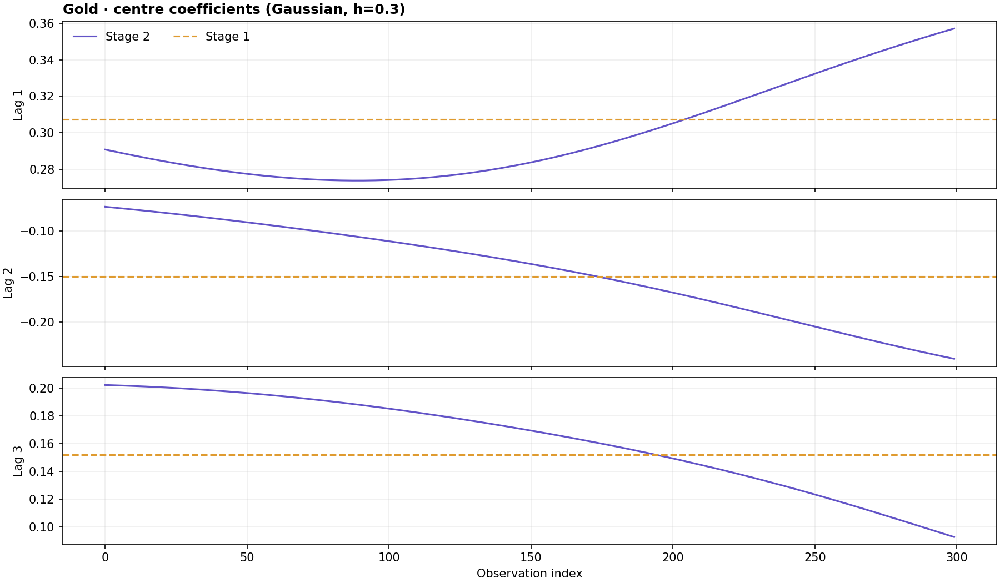
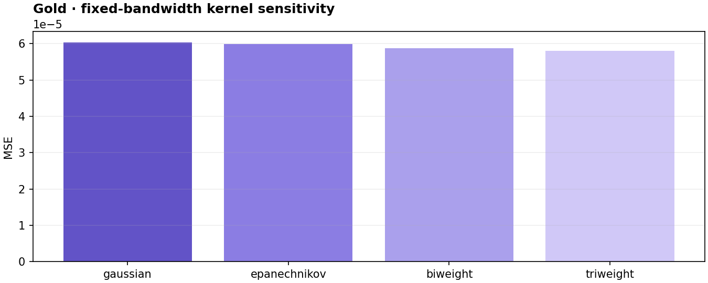
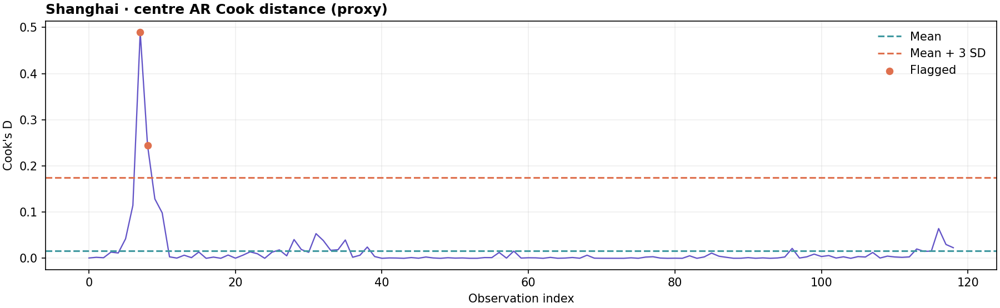
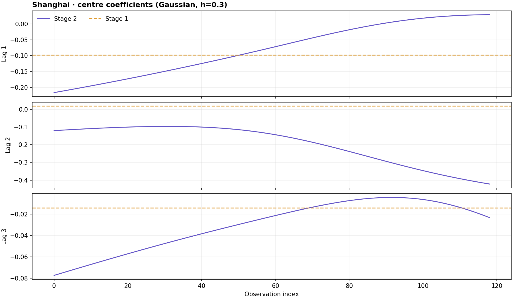
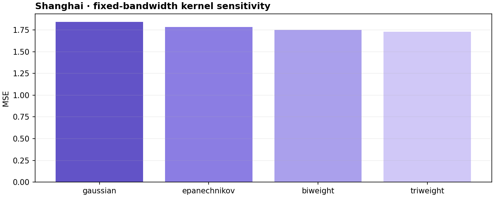

### 论文报告的结果（未独立复现）

下表直接摘录论文表 1、表 2 的作者报告结果，**不是本仓库程序复算结果**。金融数据的 MSE、MAE 分别以 10⁻⁶、10⁻³ 为单位；上海气温数据使用论文表中的原始数值。气温第二阶段的 MAE 在正文中另写为 0.6602，表中为 0.6620。

| 算例 | 模型 | MSE | MAE | MSM |
|---|---|---:|---:|---:|
| 深证成指 | 第一阶段 | 1.3606 | 2.6392 | 0.6165 |
| 深证成指 | 第二阶段 | 0.6822 | 1.7334 | 0.7033 |
| 黄金价格 | 第一阶段 | 2.7441 | 3.6320 | 0.5481 |
| 黄金价格 | 第二阶段 | 1.5642 | 2.6927 | 0.6023 |
| 上海气温 | 第一阶段 | 2.2992 | 0.8617 | 0.5122 |
| 上海气温 | 第二阶段 | 1.8799 | 0.6620 | 0.5611 |

### 补充实验：公开真实数据（样本内拟合）

下表由本仓库代码实际计算，使用 [Nile](https://www.statsmodels.org/stable/datasets/generated/nile.html) 年径流及 [Sunspots](https://www.statsmodels.org/stable/datasets/generated/sunspots.html) 年太阳黑子数；两组数据不是论文原始算例，不能与上表直接比较。两者原本为精确数，本实验人为构造对称三角模糊数：中心依次除以 1000、100，左右展形均为 `0.04 + 最近至多 5 次相邻变化绝对值的均值`；该变换是补充实验的设定，并非论文采用的模糊化方法。展形使用当期观测值。使用一阶滞后、高斯核和固定带宽 0.25；参数未在本实验中调优。结果为样本内拟合，**不代表样本外预测性能**。

| 数据集 | 模型 | 拟合点数 | MSE ↓ | MAE ↓ | MSM ↑ |
|---|---|---:|---:|---:|---:|
| Nile | 第一阶段 | 99 | 0.020552 | 0.157482 | 0.392802 |
| Nile | 第二阶段 | 99 | 0.019788 | 0.153177 | 0.400243 |
| Sunspots | 第一阶段 | 308 | 0.054595 | 0.225610 | 0.315962 |
| Sunspots | 第二阶段 | 308 | 0.054535 | 0.224784 | 0.316659 |

**Nile：拟合曲线、中心残差和中心滞后系数**


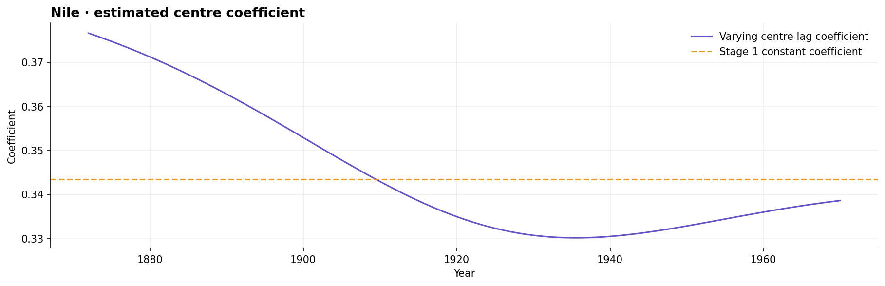

**Sunspots：拟合曲线、中心残差和中心滞后系数**

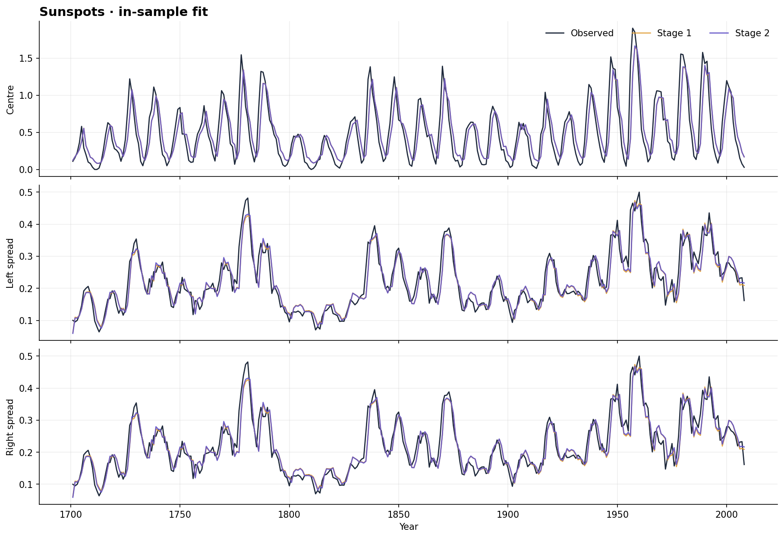


两组数据原件、逐点拟合值和实验汇总分别位于 `data/`、`results/`；来源为 statsmodels 公共领域数据集（[Nile 元数据](https://github.com/statsmodels/statsmodels/blob/main/statsmodels/datasets/nile/data.py)，[Sunspots 元数据](https://github.com/statsmodels/statsmodels/blob/main/statsmodels/datasets/sunspots/data.py)）。运行 `PYTHONPATH=. python experiments/run_benchmarks.py` 可重新生成所有结果和图片，具体数值可能受数值库版本影响。

## Install and run / 安装与运行

```bash
python -m pip install -r requirements.txt
python -m unittest discover -s tests -v
python examples/generate_demo.py
python -m spvc_fts examples/synthetic.csv --lags 1 1 1 --h-np 0.3 --h-vc 0.3
# Optional explicit candidate grid; this is substantially slower:
python -m spvc_fts examples/synthetic.csv --lags 1 1 1 --cv-grid 0.2 0.3 0.4
```

Input CSV columns: `center,left,right`. Outputs `fitted.csv` and `summary.json`. The example is **synthetic**, used only to verify the code runs; it is not paper data. Output numbers measure **in-sample fit**, not future forecasting performance. The prediction arrays can contain nonpositive spreads because the paper does not specify a positivity-constrained optimizer. Their count is reported, and MSM is null if any spread is nonpositive. No silent clipping is performed.

## Model and implementation choices / 模型及实现约定

- Stage 1 uses equations (1)–(3), normalized kernel smoothing of centre residuals, and iterative reweighted nonlinear least squares with weights `1/(1+d²)`; stage 2 locally minimizes the fuzzy squared distance with the fixed stage-1 smooth trend. For triangular fuzzy numbers the distance weights are `(2/3, 1/3, 1/3)`.
- Gaussian, Epanechnikov, biweight and triweight kernels are available. Explicit bandwidth grids are required; the paper specifies a 0.01 increment but no finite upper bound. The example grid and default bandwidth are illustrative, not values extracted from the paper. Compact kernels require sufficient local observations; unsupported folds are marked invalid.
- CV removes each target response from the regression rows and smoothing; stage 2 refits stage 1 per fold. Other rows retain lagged observations from the original series, including the held-out observation. Hence this is **leave-one-response-out**, not strict removal of all dependent lagged values, and not rolling-origin forecasting. The paper does not unambiguously specify this detail.
- MSE and MAE are the sample means of componentwise **sums** per paper §2.3. MSM is fuzzy-cardinality intersection/union computed by exact piecewise-linear integration for triangular fuzzy numbers. It requires strictly positive spreads.
- `financial_returns(low, high)` implements paper p. 15 in natural-log units. Table 1 expresses MSE in 10⁻⁶ and MAE in 10⁻³; raw output must be scaled to compare with the table. `temperature_fuzzy(values)` implements p. 17 using population variance. A point whose normal tail contains at most 0.05 probability has no finite spread satisfying the stated equation; this raises an error rather than inventing a workaround.

## Unresolved reproduction issues / 待解决问题

1. The PDF does not provide the authors’ original observations, exact providers or market conventions. This repository uses alternate datasets, including Shanghai temperatures from 2017; it also explicitly assumes differencing before fuzzification.
2. Exact kernel selections, practical bandwidth search limits, numerical optimizer and convergence settings are not fully specified. Obtaining original code/data would help distinguish assumptions from the authors' implementation.
3. Section 3.2 text reports temperature MAE 0.6602, whereas Table 2 reports 0.6620. Both are retained pending confirmation.
4. Except for an explicitly defined illustrative centre-only AR baseline, the paper's other baseline models and result tables have not been independently reproduced. No synthetic result should be compared as if it were a paper result. Add source provenance, exact data and chronological evaluation before making accuracy claims.
